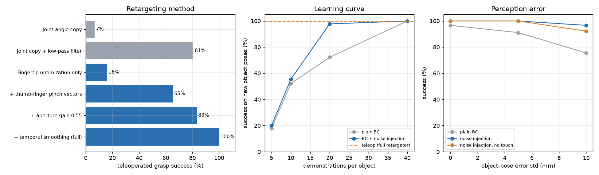
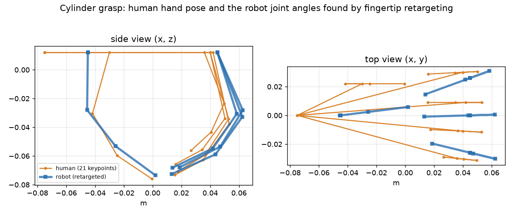

# Dexterous Hand Teleoperation: Human-to-Robot Retargeting and Imitation Learning

[](https://github.com/vansh0906/dexhand-retargeting-bc/actions/workflows/ci.yml)

A **teleoperation-to-learned-policy pipeline for a multi-fingered robot hand**, built in **MuJoCo** and Python:

1. A tracked **human hand** (21 keypoints, the output format of camera hand trackers) performs grasps.
2. **Retargeting** turns each human hand pose into joint angles for a **16-DOF, 4-finger robot hand** with different proportions.
3. The robot hand executes the grasps in physics, with **fingertip touch sensors**, and the successful ones are recorded.
4. A **behaviour-cloning policy** (a NumPy MLP written from scratch) learns from those demonstrations and grasps objects **on its own** at poses it has never seen.

Every result is checked against a written requirement, and CI fails if one is missed.



## How it works

| Stage | File | What it does |
|---|---|---|
| Robot hand | `hand.py` | MuJoCo model: thumb + 3 fingers, each with abduction and 3 flexion joints (16 position-controlled joints), on a 4-DOF wrist; a **touch sensor on every fingertip**; cube, cylinder and sphere objects |
| Human hand | `human.py` | Kinematic 5-finger human hand (adult proportions, 21 keypoints). A demonstration is approach → descend → close → squeeze → lift → hold, with person-to-person posture variation, **4 mm keypoint jitter and 3 mm wrist jitter** like a camera hand tracker |
| Retargeting | `retarget.py` | **Baseline:** copy the human joint angles. **Fingertip optimization:** robot joint angles whose fingertips match the scaled human fingertips, plus **thumb-to-finger pinch vectors** switched on as the hand closes, an **aperture gain** so the fingers keep pressing after contact, and a **temporal-smoothness** term. Damped least squares with **MuJoCo Jacobians**, joint limits by an active set |
| Teleoperation | `teleop.py` | Plays a human demonstration through a retargeter into the simulated hand and records (observation, action) pairs. Optional **noise injection** (DART-style): perturb what is executed, keep the demonstration's label, so the data shows how to recover from small mistakes |
| Environment | `sim.py` | 20 Hz control. Observation (30-D): object position and yaw in the hand frame, palm height, 16 finger joint angles, object type, episode progress, 4 fingertip forces. Action (20-D): palm motion + 16 finger targets |
| Learning | `bc.py` | Two-layer MLP (256 units, ReLU) with Adam and cosine decay, written in NumPy; closed-loop evaluation on new object poses, with optional object-pose errors |
| Checks | `tests.py` | 18 checks: model structure, keypoint geometry, joint-copy exactness, Jacobian vs. finite differences, retargeting accuracy and limits, action conversions, MLP fit, an end-to-end grasp with touch readings |



## Results

<!-- results:start -->
```text
[1  Retargeting a tracked human hand onto the robot hand: 50 demonstrations per object, 150 per method]
  human: 5 fingers, 21 tracked keypoints with 4 mm jitter, wrist 3 mm; robot: 4 fingers, 16 joints, different link lengths and finger placement
  method                            success  cube  cyl. sphere  tip err    open  chatter solve p95  failures
  Joint-angle copy                       7%   10%    8%     2%   18.2mm  14.5mm   0.768    0.04ms  dropped 140
  Joint copy + low-pass filter          81%  100%   76%    66%   16.0mm  12.7mm   0.177    0.04ms  dropped 29
  Fingertip optimization only           16%   18%   10%    20%    3.9mm   8.3mm   0.184    1.14ms  dropped 126
  + thumb-finger pinch vectors          65%   84%   54%    58%    9.3mm   8.3mm   0.142    2.81ms  dropped 52
  + aperture gain 0.55                  83%   92%   84%    74%   10.5mm   8.3mm   0.111    2.81ms  dropped 25
  + temporal smoothing (full)          100%  100%  100%   100%   11.9mm   9.7mm   0.050    1.26ms  -
  success = object lifted 8 cm and still held after 0.8 s; tip err = mean distance of robot fingertips from the scaled human fingertips
  (whole demo / open hand during approach; while grasping the pinch terms pull the tips together on purpose);
  chatter = RMS change of the finger commands per step (rad) while holding; solve p95 = retargeting time per frame, 95th percentile

[2  Recording demonstrations for imitation learning: 60 teleoperated attempts per object, full retargeter]
  plain                  teleop success  99.4%  kept 179 successful demos, 19153 (observation, action) pairs; obs 30-D, action 20-D
  noise injection 4 mm   teleop success  98.3%  kept 177 successful demos, 18939 (observation, action) pairs; obs 30-D, action 20-D

[3  Behaviour cloning, closed loop on new object poses (30 per object): learning curve]
  demos per object  plain BC  with noise injection
                 5       18%                   20%
                10       52%                   56%
                20       72%                   98%
                40      100%                  100%

[4  Robustness to object-pose errors (constant offset per episode, std shown, + 1 mm jitter), 40 demos per object]
  policy                           0 mm     5 mm    10 mm
  plain BC                          97%      91%      76%
  noise injection                  100%     100%      97%
  noise injection, no touch        100%     100%      92%
  failures of the noise-injection policy at 10 mm: dropped 1, not lifted 2

ID   Requirement                                         Result      Target  Status
R1   Teleop success, full retargeter                      100 %     >= 90 %  PASS
R2   Fingertip retargeting vs. joint copy               +93 pts  >= +50 pts  PASS
R3   Fingertip retargeting vs. filtered joint copy      +19 pts  >= +10 pts  PASS
R4   Fingertip error, open hand (full retargeter)        9.7 mm    <= 12 mm  PASS
R5   Smoothing cuts finger-command chatter                -55 %     >= 50 %  PASS
R6   Retargeting time per frame (p95)                    1.3 ms     <= 5 ms  PASS
R7   BC success on new poses (40 demos/object)            100 %     >= 90 %  PASS
R8   BC vs. teleop success                               +0 pts   >= -5 pts  PASS
R9   BC with 10 mm object-pose error (best policy)         97 %     >= 70 %  PASS
9/9 requirements pass

saved results.png, hands.png  (total 14005 s)
```
<!-- results:end -->

## What the results say

- **Copying joint angles does not work across hands.** Sending the human joint angles straight to the robot lifted the object in 7 % of attempts; the robot's fingers are placed and sized differently, and tracker jitter makes the fingers chatter.
- **Matching fingertips alone is not enough either (17 %).** The fingertips land where the human's are, but the grasp has no squeeze. The **thumb-to-finger pinch vectors** (65 %) and the **aperture gain** that keeps the fingers pressing after contact (84 %) are what turn tracking accuracy into a stable grasp.
- **Tracker jitter was the main cause of dropped objects.** The 4 mm keypoint noise made finger commands chatter while the object was held. A temporal-smoothness term in the solver cut that chatter by 55 % and took teleoperated success from 84 % to 100 % on all three objects. The fair comparison is with a low-pass-filtered joint copy (81 %): fingertip retargeting is still 19 points better, the gap coming from the round objects (cylinder 76 % → 100 %, sphere 66 % → 100 %).
- **The learned policy matches teleoperation with 40 demonstrations per object** (100 % on 90 new object poses). With fewer demonstrations, noise injection while recording is what makes the difference: 96 % vs. 71 % at 20 demonstrations per object.
- **Noise injection also makes the policy robust to a biased object-pose estimate:** with 10 mm of error, 96 % vs. 76 % for plain behaviour cloning. Removing the fingertip touch inputs dropped that to 89 %.
- **Retargeting runs at 1.7 ms per frame (95th percentile)**, fast enough for live teleoperation at well over 100 Hz.

## Run it

```bash
python3 -m venv .venv && source .venv/bin/activate
pip install -r requirements.txt
export MUJOCO_GL=disable                 # physics only; no display needed
python tests.py                          # 18 checks, about 10 seconds
python run_all.py | tee results.txt      # about 6 minutes on 2 cores; results.png and hands.png
python tools/readme_results.py           # copies results.txt into this README
```

## Limitations

- Everything is simulated. The human hand is a kinematic model with tracker-like noise, not recordings from a real tracker or glove, and the robot hand is a simplified capsule model rather than a specific commercial hand.
- Grasps are top-down fingertip grasps of three rigid objects on a table; no in-hand manipulation, no clutter, no deformable objects.
- The policy receives the object pose directly (with added errors in section 4) rather than from camera images.
- The touch sensors report normal force per fingertip, not a taxel image, and contact physics is MuJoCo's soft-contact model with high fingertip friction (2.0, rubber-like).
- Results are from one training seed per setting; section 4 trains its plain policy with a different seed from section 3, which is why its 0 mm number (97 %) differs from the learning curve (100 %).
